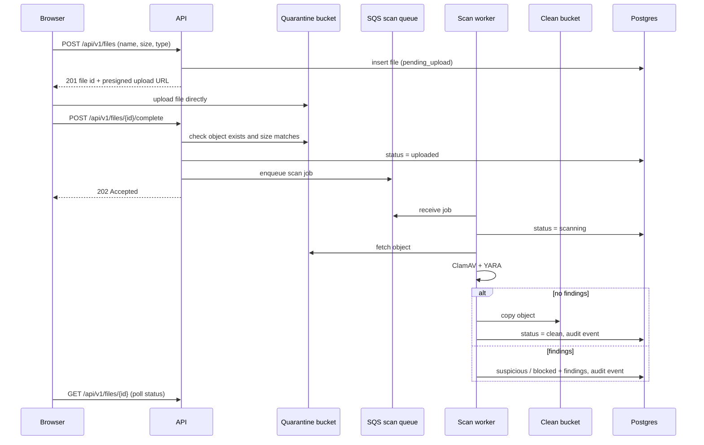
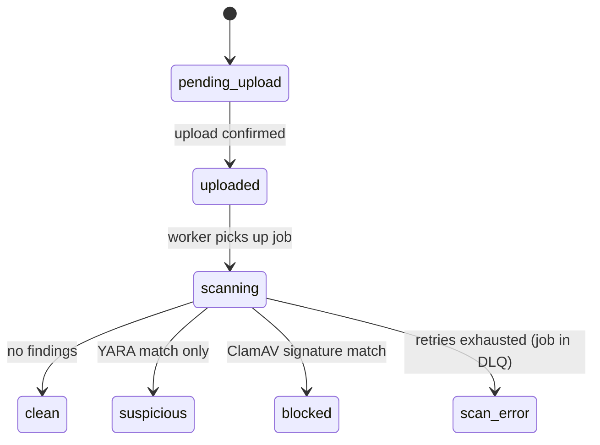

# HygieAI: Design Doc

**Status:** Draft (Week 1) · **Last updated:** 2026-10-17

## 1. Problem

People share files with links, and recipients tend to open whatever arrives from someone they know. A malicious file shared from a trusted or compromised account is a common way malware spreads. Most file-sharing tools either don't scan, or scan after the file is already downloadable.

HygieAI guarantees that **no file can be downloaded until it has been scanned and found clean**. When something is found, it explains the findings to the owner in plain language.

## 2. Users

| User | Can do |
|---|---|
| **Owner** (registered account) | Upload files, see scan status and findings, download their own clean files, create and revoke share links, view the audit log for their files. |
| **Recipient** (holds a share link) | Download a file only while the link is valid **and** the file is `clean`. Whether recipients need an account is decided in Week 4. |

## 3. Scope (v1)

- Account registration, login, refresh and logout.
- Direct browser-to-storage uploads with an enforced size limit.
- Every file scanned (ClamAV + YARA) by an isolated worker before it can be downloaded.
- Fail closed: any status other than `clean` blocks download.
- Downloads through 60-second presigned links from the clean bucket only.
- Share links with expiry and revocation.
- An audit log of security-relevant events.
- LLM-generated explanations of scan findings.
- Deployed to AWS with Terraform; CI on every push.

## 4. Non-goals (for now)

| Not doing | Why |
|---|---|
| Private end-to-end encrypted mode | Conflicts with server-side scanning; see [ADR-0001](adr/0001-scanning-vs-e2e-encryption.md). Planned later. |
| ML malware classifier | Signatures and rules are explainable and testable; ML needs training data and evaluation work. |
| WebSockets | Scans take seconds; polling every few seconds is enough and needs no extra infrastructure. |
| Resumable uploads | The size limit keeps uploads small. |
| 2FA | Important, but deferred; auth is designed so it can be added later. |
| Hash-chained (tamper-evident) audit log | v1 audit log is append-only by convention; tamper evidence comes later. |
| Microservices, Kubernetes, full AWS network design, load testing | One VM running Docker Compose is enough at portfolio scale. A modular monolith keeps clear boundaries without the operational cost. |
| Catching all malware | Scanning reduces risk; it does not eliminate it. The UI must never claim a file is "safe", only that no threats were found. |

## 5. Architecture

**Components**
- **Web:** React SPA.
- **API:** FastAPI modular monolith (routes → services → repositories → models).
- **Scan worker:** separate process, on a network with no general internet access.
- **PostgreSQL:** users, files, findings, audit events.
- **S3:** a quarantine bucket (uploads land here) and a clean bucket (downloads come only from here).
- **SQS:** scan queue plus a dead-letter queue.
- **LLM provider:** behind a provider-agnostic interface.

**Upload and scan flow**

**Download flow:** `GET /api/v1/files/{id}/download` → API checks ownership (or a valid share link) **and** `status == clean` → returns a 60-second presigned GET URL for the clean bucket.

**File states**

- `blocked`: matches a known-malware signature.
- `suspicious`: matches a heuristic YARA rule but no known signature.
- `scan_error`: the scan could not complete. Treated exactly like a threat for download purposes.

## 6. Security principles

1. **Fail closed.** Download requires `status == clean`. Unknown, missing or error states deny.
2. **Least privilege.** The API can write to quarantine and read from clean. Only the worker can write to the clean bucket, so only a completed scan can make a file downloadable.
3. **Short-lived access.** Upload and download URLs expire quickly; access tokens are short-lived.
4. **Isolated scanning.** Untrusted files are only ever opened by the worker, which has no general internet access.
5. **The LLM never sees file contents.** It receives only scan metadata (rule names, signature names, file type), so the content can't leak to a third party or prompt-inject the model.
6. **Size limits enforced by storage**, not just by the client (presigned POST with a content-length range).

## 7. Open questions

- **Worker network isolation in AWS.** The worker still needs S3, SQS and Postgres. Options: VPC endpoints, or an egress proxy with an allowlist. Decide in Week 5.
- **ClamAV signature updates.** `freshclam` needs internet. Plan: a separate updater container downloads signatures to a shared volume that the worker mounts read-only.
- **Recipient accounts** (Week 4).
- **Abandoned uploads** stuck in `pending_upload`: cleanup job and S3 lifecycle rule.
